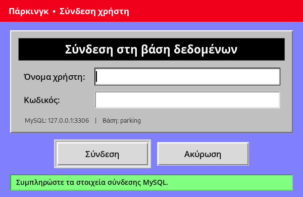
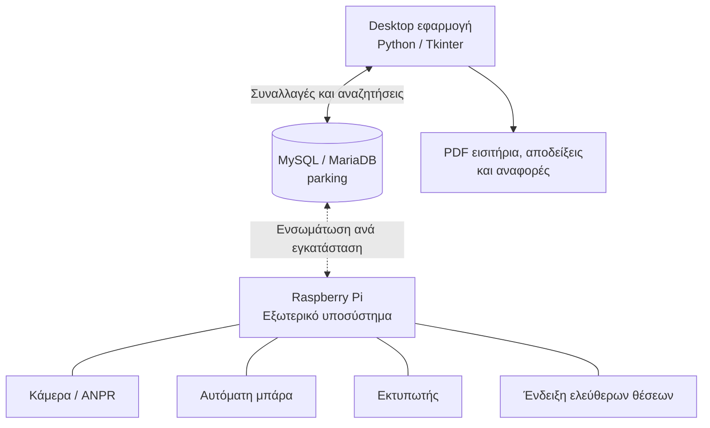

# Project Parking

### Σύστημα διαχείρισης χώρου στάθμευσης με Python, MySQL και συνοδευτικό hardware Raspberry Pi

Το **Project Parking** είναι ένα σύστημα διαχείρισης ιδιωτικού ή επαγγελματικού χώρου στάθμευσης. Συνδυάζει εφαρμογή γραφείου για τη διαχείριση οχημάτων, χρεώσεων, συνδρομών και παραστατικών με **ξεχωριστή υλοποίηση hardware βασισμένη σε Raspberry Pi** για τον αυτοματισμό της εισόδου και εξόδου.

Η desktop εφαρμογή έχει αναπτυχθεί σε **Python / Tkinter** και χρησιμοποιεί **MySQL ή MariaDB** ως κεντρική βάση δεδομένων. Η εφαρμογή δημιουργεί αρχεία PDF για εισιτήρια, αποδείξεις και αναφορές, καταγράφει τις κινήσεις των οχημάτων και ενημερώνει τις διαθέσιμες θέσεις σε κάθε ολοκληρωμένη είσοδο ή έξοδο.

> **Έκταση αυτού του αποθετηρίου:** Περιλαμβάνει τη desktop εφαρμογή, τα επιμέρους Python modules, το σχήμα της βάσης και τους πόρους του GUI. Το συνοδευτικό hardware Raspberry Pi και η **υπάρχουσα ξεχωριστή υλοποίηση διασύνδεσης με την ΑΑΔΕ** αποτελούν τμήματα του συνολικού έργου, **αλλά ο κώδικάς τους δεν περιλαμβάνεται σε αυτό το repository**.

---

## Περιεχόμενα

- [Στιγμιότυπα εφαρμογής](#στιγμιότυπα-εφαρμογής)
- [Βασικές δυνατότητες](#βασικές-δυνατότητες)
- [Υποσύστημα Raspberry Pi](#υποσύστημα-raspberry-pi)
- [Αρχιτεκτονική](#αρχιτεκτονική)
- [Πώς λειτουργεί](#πώς-λειτουργεί)
- [Εγκατάσταση](#εγκατάσταση)
- [Πρώτη παραμετροποίηση](#πρώτη-παραμετροποίηση)
- [Δομή έργου](#δομή-έργου)
- [Βάση δεδομένων](#βάση-δεδομένων)
- [Αντιμετώπιση προβλημάτων](#αντιμετώπιση-προβλημάτων)
- [Περιορισμοί και εκκρεμότητες](#περιορισμοί-και-εκκρεμότητες)

## Στιγμιότυπα εφαρμογής

Οι παρακάτω εικόνες είναι **πραγματικά screenshots του Tkinter GUI όπως εκτελέστηκε από τον πηγαίο κώδικα** (`parking_app.py` και `parking_modules/`). **Δεν είναι** τα εικονίδια και τα λοιπά PNG που υπάρχουν στα αρχεία του project.

Για τη λήψη τους χρησιμοποιήθηκε δοκιμαστικό περιβάλλον Linux/Xvfb με προσωρινή προσομοίωση των απαντήσεων MySQL, επειδή δεν διατίθεται βάση παραγωγής στην παρούσα εγκατάσταση. Οι εικόνες αποτυπώνουν τις **πραγματικές φόρμες του προγράμματος**, με ενδεικτικές τιμές. Δεν αποτελούν επιβεβαίωση επιτυχούς πραγματικής τιμολόγησης ή φυσικής κίνησης μπάρας.

**Παράθυρο σύνδεσης στη βάση δεδομένων**



**Φόρμα εισόδου οχήματος και ένδειξη ελεύθερων θέσεων**


**Φόρμα εξόδου οχήματος και υπολογισμού πληρωτέου ποσού**


> Για να εμφανίζονται οι εικόνες στο GitHub, ανεβάστε **και** τα τρία PNG στον φάκελο `docs/screenshots/` του repository. Οι διαδρομές των εικόνων είναι σχετικές με τη θέση του `README.md` στη ρίζα του project.

## Βασικές δυνατότητες

| Λειτουργία | Περιγραφή |
|---|---|
| **Είσοδος οχημάτων** | Καταχώριση πινακίδας και χρόνου εισόδου, έκδοση μοναδικού αριθμού εισιτηρίου, δημιουργία εισιτηρίου PDF με QR code. |
| **Έξοδος οχημάτων** | Αναζήτηση ενεργής εισόδου, υπολογισμός διάρκειας παραμονής και χρέωσης, καταχώριση εξόδου, δημιουργία απόδειξης PDF με barcode. |
| **Διαθέσιμες θέσεις** | Αφαίρεση μίας θέσης κατά την είσοδο και προσθήκη μίας κατά την έξοδο, με ενημέρωση της ένδειξης στην εφαρμογή. |
| **Τιμολόγηση** | Επεξεργάσιμοι κανόνες χρονικής χρέωσης, τιμοκατάλογος συνδρομών και ποσοστό ΦΠΑ. |
| **Συνδρομές** | Δημιουργία, αναζήτηση, διόρθωση και διαγραφή συνδρομών, με χρονική ισχύ και παραγωγή αντίστοιχων παραστατικών. |
| **Συμβατότητα συνδρομών με χρέωση στάθμευσης** | Κατά την έξοδο, το διάστημα που καλύπτεται από συνδρομή αφαιρείται από τον χρόνο προς χρέωση, ακόμη και σε μερική κάλυψη. |
| **Αναζητήσεις και ιστορικό** | Εντοπισμός εγγραφών και ιστορικού ανά πινακίδα. |
| **Στατιστικά** | Γραφήματα και αναφορές για κινήσεις/ώρες στάθμευσης και περιόδους συνδρομών. |
| **Στοιχεία επιχείρησης** | Παραμετροποίηση επωνυμίας, ΑΦΜ, ΔΟΥ, διεύθυνσης και στοιχείων επικοινωνίας που χρησιμοποιούνται στα PDF. |
| **Εντολές μπάρας** | Εγγραφή εντολών εισόδου/εξόδου στον πίνακα `door` της MySQL, ώστε να μπορούν να καταναλωθούν από εξωτερικό ελεγκτή. |

### Έλεγχοι ακεραιότητας

Ο κώδικας περιλαμβάνει πρόσθετους ελέγχους για την αποφυγή προβληματικών καταχωρίσεων:

- Δεν επιτρέπει νέα είσοδο όταν οι διαθέσιμες θέσεις είναι μηδέν.
- Ελέγχει αν η πινακίδα έχει ήδη ενεργή είσοδο.
- Χρησιμοποιεί συναλλαγές MySQL και `SELECT ... FOR UPDATE` σε κρίσιμες ενημερώσεις θέσεων.
- Κατά την έξοδο ελέγχει ότι ενημερώθηκε ακριβώς μία ενεργή εγγραφή εισόδου.
- Διαχωρίζει την επιτυχημένη καταχώριση στη βάση από πιθανή αποτυχία δημιουργίας PDF, ώστε να μην προκαλείται διπλή καταχώριση με επανάληψη της ενέργειας.
- Περιλαμβάνει λογική διαχείρισης επικαλυπτόμενων χρονικών διαστημάτων συνδρομών στον υπολογισμό χρέωσης.

## Υποσύστημα Raspberry Pi

Για το συνολικό Project Parking έχει αναπτυχθεί και **αντίστοιχο hardware με Raspberry Pi**, το οποίο επεκτείνει το λογισμικό σε φυσική εγκατάσταση στάθμευσης.

Το hardware περιλαμβάνει τις ακόλουθες λειτουργικές δυνατότητες:

1. **Κάμερα αναγνώρισης πινακίδων:** Λήψη εικόνας και υποστήριξη αναγνώρισης αριθμού κυκλοφορίας για τον αυτοματισμό της ταυτοποίησης οχημάτων (*Automatic Number Plate Recognition / ANPR*).
2. **Αυτόματη μπάρα εισόδου και εξόδου:** Διασύνδεση με τον μηχανισμό ελέγχου πρόσβασης, ώστε η κίνηση της μπάρας να εντάσσεται στη ροή εισόδου/εξόδου.
3. **Εκτύπωση εισιτηρίων και αποδείξεων:** Συνοδευτική υποστήριξη εκτυπωτή στο φυσικό σημείο εξυπηρέτησης.
4. **Αυτόματη απεικόνιση ελεύθερων θέσεων:** Ενημέρωση εξωτερικής ένδειξης/οθόνης με τις διαθέσιμες θέσεις στάθμευσης.

**Σημαντική διάκριση:** Το παρόν repository περιέχει τον κώδικα της **desktop εφαρμογής**, τη βάση δεδομένων και τα αρχεία της. **Δεν περιλαμβάνει** το λογισμικό Raspberry Pi, τους οδηγούς καμερών, το μοντέλο αναγνώρισης πινακίδων, το κύκλωμα μπάρας ή τις προδιαγραφές του εκτυπωτή/οθόνης. Κατά συνέπεια, οι λεπτομερείς οδηγίες εγκατάστασης αυτών των συσκευών εξαρτώνται από τη χωριστή υλοποίηση του hardware και δεν τεκμηριώνονται με εικασίες εδώ.

## Αρχιτεκτονική



Η εφαρμογή αποθηκεύει τις επιχειρησιακές εγγραφές στη βάση `parking`. Για τις εντολές μπάρας χρησιμοποιεί ειδικά τα πεδία `door.stagein` και `door.stageout`: ο κώδικας γράφει **`1` και στη συνέχεια `0`** (με χρονική καθυστέρηση περίπου ενός δευτερολέπτου μεταξύ των εγγραφών). Αυτό είναι **σήμα εντολής στη βάση**, όχι απευθείας οδήγηση GPIO από τη desktop εφαρμογή ούτε επιβεβαίωση ότι άνοιξε φυσικά η μπάρα. Ο εξωτερικός ελεγκτής πρέπει να παρακολουθεί και να χειρίζεται σωστά το σήμα.

Ο αριθμός διαθέσιμων θέσεων διατηρείται στον πίνακα `places`, στο πεδίο `remaneplaces`, και μπορεί να χρησιμοποιηθεί από το αντίστοιχο υποσύστημα εξωτερικής απεικόνισης.

## Πώς λειτουργεί

### 1. Εκκίνηση και σύνδεση

Η εφαρμογή εκκινεί με **παράθυρο σύνδεσης MySQL**. Ο χειριστής πληκτρολογεί όνομα χρήστη και κωδικό πρόσβασης στη βάση `parking`. Πριν εμφανιστεί το κύριο περιβάλλον, ελέγχεται η σύνδεση και η ύπαρξη της αρχικής εγγραφής διαθέσιμων θέσεων (`places.id = 1`). Τα διαπιστευτήρια διατηρούνται στη μνήμη της διεργασίας και δεν αποθηκεύονται σε αρχείο ρυθμίσεων από τη μονάδα σύνδεσης.

Το κύριο περιβάλλον οργανώνεται στις επιλογές **Είσοδος οχημάτων**, **Έξοδος οχημάτων**, **Συνδρομές**, **Χρεώσεις** και **Ευρετήριο**.

### 2. Είσοδος οχήματος

1. Καταχωρίζεται η πινακίδα κυκλοφορίας και προαιρετικά παρατηρήσεις.
2. Ελέγχεται αν το όχημα βρίσκεται ήδη εντός του χώρου και αν υπάρχει ελεύθερη θέση.
3. Δημιουργείται εγγραφή εισόδου με ημερομηνία, ώρα και αριθμό εισιτηρίου.
4. Το πλήθος των ελεύθερων θέσεων μειώνεται κατά **1** στην ίδια συναλλαγή MySQL.
5. Δημιουργείται εισιτήριο **PDF με QR code** στον φάκελο `INs/`.
6. Εφόσον ολοκληρωθεί η παραγωγή του PDF, η εφαρμογή παράγει παλμό εντολής εισόδου στο `door.stagein`.

Στη συνολική εγκατάσταση Raspberry Pi, η κάμερα μπορεί να εξυπηρετεί την αναγνώριση πινακίδας, ενώ ο εξωτερικός ελεγκτής χειρίζεται τη φυσική μπάρα και τον εκτυπωτή. Η συγκεκριμένη επικοινωνία υλοποιείται στο ξεχωριστό hardware/software subsystem.

### 3. Έξοδος οχήματος

1. Αναζητείται η **ενεργή είσοδος** με βάση την πινακίδα.
2. Ανακτώνται ο αριθμός εισιτηρίου, ο χρόνος εισόδου και οι υπόλοιπες πληροφορίες της επίσκεψης.
3. Υπολογίζεται η συνολική διάρκεια στάθμευσης.
4. Εξετάζονται οι συνδρομές του οχήματος και αφαιρείται η χρονική κάλυψή τους από τη χρεώσιμη διάρκεια.
5. Η εναπομένουσα διάρκεια τιμολογείται σύμφωνα με τις καθορισμένες χρονικές φάσεις και εφαρμόζεται το παραμετροποιημένο ποσοστό ΦΠΑ.
6. Η ενεργή είσοδος χαρακτηρίζεται ολοκληρωμένη, προστίθεται εγγραφή εξόδου και οι διαθέσιμες θέσεις αυξάνονται κατά **1**.
7. Παράγεται **PDF απόδειξης με barcode** στον φάκελο `OUTs/`.
8. Μετά την παραγωγή του PDF, αποστέλλεται η εντολή εξόδου μέσω `door.stageout`.

### 4. Συνδρομές

Υποστηρίζονται πακέτα διάρκειας, όπως **7, 15 ή 30 ημερών** στα αρχικά δεδομένα της βάσης, με δυνατότητα αλλαγής του τιμοκαταλόγου. Για κάθε συνδρομή αποθηκεύονται στοιχεία οχήματος/πελάτη, χρονικά όρια και ποσά. Παρέχονται αναζήτηση, διόρθωση και διαγραφή, καθώς και PDF παραστατικά συνδρομής.

Οι ενεργές συνδρομές λαμβάνονται υπόψη στον υπολογισμό εξόδου. Για παράδειγμα, αν μία στάθμευση καλύπτεται μόνο εν μέρει από συνδρομή, χρεώνεται **μόνο το μη καλυπτόμενο χρονικό τμήμα**, με βάση τη λογική τιμολόγησης της εφαρμογής.

### 5. Χρεώσεις, αναφορές και ιστορικό

Ο διαχειριστής μπορεί να ρυθμίσει τα τιμολόγια ανά χρονικό διάστημα, το κόστος των συνδρομών, τον ΦΠΑ, τα στοιχεία της επιχείρησης και την αρχική διαθεσιμότητα θέσεων. Το ευρετήριο επιτρέπει αναζήτηση εγγραφών οχημάτων και το τμήμα στατιστικών δημιουργεί γραφήματα/αναφορές.

---

## Εγκατάσταση

### Απαιτήσεις

- **Windows 10/11**, ως προτεινόμενο περιβάλλον για το υπάρχον Tkinter GUI και τη χρήση του `p.ico`.
- **Python 3** με `pip` και υποστήριξη **Tkinter** (για νέα εγκατάσταση προτείνεται Python 3.11 ή νεότερη, με έλεγχο συμβατότητας των εξαρτήσεων).
- **MySQL Server ή MariaDB Server** σε λειτουργία.
- Πρόσβαση στο τοπικό σύστημα αρχείων για τη δημιουργία και διατήρηση PDF και εικόνων.

Το αρχικό SQL dump προέρχεται από περιβάλλον **MariaDB 10.4**. Η ακριβής συμβατότητα κάθε άλλης έκδοσης ή λειτουργικού συστήματος πρέπει να επιβεβαιωθεί κατά την εγκατάσταση.

### Βήμα 1 — Λήψη των αρχείων από το GitHub

Κατεβάστε/κλωνοποιήστε το αποθετήριο και μεταβείτε στον φάκελο όπου βρίσκεται το `parking_app.py`:

```bat
git clone <URL-ΤΟΥ-ΑΠΟΘΕΤΗΡΙΟΥ> project-parking
cd project-parking
```

Τα αρχεία πρέπει να ανέβουν **ξεχωριστά** στο GitHub, με την ίδια διάταξη φακέλων όπως στο αρχικό project. Το `parking_app.py`, το `requirements.txt` και το `README.md` τοποθετούνται στη **ρίζα του repository**. Οι φάκελοι `parking_modules/`, `sql/`, `docs/screenshots/` και οι φάκελοι εξόδου διατηρούνται ως υποφάκελοι. Οι εντολές που ακολουθούν εκτελούνται από τη ρίζα του project, εκεί όπου βρίσκεται το `parking_app.py`.

### Βήμα 2 — Εγκατάσταση βιβλιοθηκών Python

Σε **Command Prompt (cmd.exe)** μέσα στον φάκελο του project:

```bat
py -3 -m venv .venv
.venv\Scripts\activate.bat
python -m pip install --upgrade pip
python -m pip install -r requirements.txt
```

Το `requirements.txt` περιλαμβάνει:

```text
mysql-connector-python
tkcalendar
python-dateutil
matplotlib
numpy
pandas
python-barcode
Pillow
qrcode
reportlab
```

Το **Tkinter** ανήκει συνήθως στην εγκατάσταση Python για Windows και δεν εμφανίζεται στο `requirements.txt`. Η βιβλιοθήκη `lytrax_afm` είναι **προαιρετική**: αν απουσιάζει, η εφαρμογή περιέχει εφεδρικό έλεγχο εγκυρότητας ελληνικού ΑΦΜ.

### Βήμα 3 — Δημιουργία βάσης δεδομένων

Η βάση πρέπει να ονομάζεται **`parking`**, επειδή αυτό το όνομα χρησιμοποιείται στον κώδικα. Το αρχείο `sql/parking.sql` περιέχει πίνακες και αρχικές εγγραφές, **δεν δημιουργεί όμως το ίδιο τη βάση**.

Σε **cmd.exe**, εφόσον η εντολή `mysql` είναι διαθέσιμη στο `PATH`:

```bat
mysql -u root -p -e "CREATE DATABASE IF NOT EXISTS parking CHARACTER SET utf8 COLLATE utf8_general_ci;"
mysql -u root -p parking < sql\parking.sql
```

Θα ζητηθεί ο κωδικός MySQL. Εναλλακτικά, δημιουργήστε τη βάση από **phpMyAdmin / MySQL Workbench** και εισάγετε σε αυτήν το `sql/parking.sql`.

> **Προσοχή:** Η εισαγωγή του SQL αρχείου προορίζεται για **νέα, κενή βάση**. Μην το εισάγετε ξανά σε παραγωγική εγκατάσταση με πραγματικές κινήσεις χωρίς αντίγραφο ασφαλείας.

### Βήμα 4 — Δημιουργία χρήστη MySQL

Για κανονική χρήση προτιμήστε ειδικό χρήστη αντί του διαχειριστικού `root`. Για παράδειγμα, εκτελέστε τα παρακάτω ως διαχειριστής MySQL, αφού προσαρμόσετε τον κωδικό:

```sql
CREATE USER 'parking_user'@'127.0.0.1' IDENTIFIED BY 'CHANGE_ME_STRONG_PASSWORD';
GRANT SELECT, INSERT, UPDATE, DELETE ON parking.* TO 'parking_user'@'127.0.0.1';
```

Σε εγκαταστάσεις στις οποίες η σύνδεση πραγματοποιείται από διαφορετικό host ή εμφανίζεται σφάλμα δικαιωμάτων, προσαρμόστε τον ορισμό χρήστη/host σύμφωνα με την πολιτική ασφαλείας της MySQL. **Μην εκθέτετε τη θύρα 3306 απευθείας στο Internet.**

### Βήμα 5 — Έλεγχος ρυθμίσεων σύνδεσης

Οι παράμετροι ορίζονται στο αρχείο `parking_modules/mysql_login.py`:

```python
MYSQL_HOST = "127.0.0.1"
MYSQL_DATABASE = "parking"
MYSQL_PORT = 3306
```

Αυτή είναι η προεπιλεγμένη **τοπική** σύνδεση. Για βάση σε άλλον υπολογιστή απαιτείται αλλαγή `MYSQL_HOST` και σωστή δικτυακή ρύθμιση/πρόσβαση. **Προσοχή:** σε ορισμένες λειτουργίες η σύνδεση επαναλαμβάνεται χωρίς ρητή παράμετρο `port`, επομένως για μη προεπιλεγμένη θύρα (διαφορετική από 3306) απαιτείται επιπλέον προσαρμογή του κώδικα. Το username και το password ζητούνται από το παράθυρο σύνδεσης κατά την εκκίνηση· δεν γράφονται σε αυτές τις σταθερές.

### Βήμα 6 — Εκκίνηση εφαρμογής

```bat
python parking_app.py
```

Εμφανίζεται το παράθυρο σύνδεσης MySQL. Πληκτρολογήστε τα στοιχεία του χρήστη και επιλέξτε **Σύνδεση**. Αν ο έλεγχος ολοκληρωθεί, ανοίγει το κεντρικό παράθυρο της εφαρμογής.

**Γρήγορος έλεγχος μετά την εγκατάσταση:** Η εφαρμογή πρέπει να μπορεί να διαβάσει το `places.id = 1`. Στο συνοδευτικό SQL dump η αρχική τιμή `remaneplaces` είναι **10** — ενδεικτική τιμή που πρέπει να προσαρμοστεί στον πραγματικό χώρο.

## Πρώτη παραμετροποίηση

Πριν χρησιμοποιηθεί το σύστημα σε πραγματικό χώρο στάθμευσης:

1. Ανοίξτε την ενότητα **Χρεώσεις** και εισαγάγετε τα πραγματικά στοιχεία της επιχείρησης.
2. Ελέγξτε και προσαρμόστε τον **ΦΠΑ** και τα πραγματικά τιμολόγια/χρονικές φάσεις.
3. Ορίστε τον **αριθμό διαθέσιμων θέσεων** με βάση την πραγματική κατάσταση του χώρου. Η αρχική τιμή 10 είναι μόνο δεδομένο εκκίνησης.
4. Ελέγξτε τα διαθέσιμα πακέτα συνδρομών και τις χρεώσεις τους.
5. Πραγματοποιήστε δοκιμαστική είσοδο και έξοδο και ελέγξτε τα παραγόμενα αρχεία στους φακέλους `INs/` και `OUTs/`.
6. Αν υπάρχει συνδεδεμένο hardware, ελέγξτε **ξεχωριστά** την αναγνώριση πινακίδας, την κατάσταση μπάρας, την εκτύπωση και την εξωτερική ένδειξη θέσεων πριν από κανονική λειτουργία.

**Προσοχή:** Στην αρχικοποίηση υπάρχουν ειδικές εγγραφές/τιμές αναφοράς (μεταξύ άλλων `inputcar.inputnumber = 0`, `subscription.id = 0` και εγγραφές `id = 1` σε πίνακες ρυθμίσεων). Δεν πρέπει να διαγραφούν αυθαίρετα.

## Δομή έργου

```text
Project Parking/
├── parking_app.py              # Κεντρική εφαρμογή / GUI
├── parking_modules/
│   ├── mysql_login.py          # Πιστοποίηση και παράμετροι MySQL
│   ├── entrance.py             # Είσοδοι και εισιτήρια
│   ├── departure.py            # Έξοδοι και αποδείξεις
│   ├── subscriptions.py        # Διαχείριση συνδρομών
│   ├── subscription_services.py# Έλεγχοι/υπολογισμοί και PDF συνδρομών
│   ├── pricing.py              # Χρεώσεις, ΦΠΑ, επιχείρηση, θέσεις
│   ├── directory.py            # Ευρετήριο / αναζητήσεις
│   ├── reports.py              # Γραφήματα και αναφορές
│   ├── dialogs.py              # Παράθυρα διαλόγων
│   ├── receipt_safety.py       # Χειρισμός αστοχίας PDF
│   └── system.py               # Σύνδεση και βοηθητικές λειτουργίες
├── sql/
│   ├── parking.sql             # Σχήμα και αρχικά δεδομένα
│   └── migration_subscription_id.sql
├── docs/screenshots/          # Πραγματικά screenshots του GUI
│   ├── 01-login.png
│   ├── 03-entrance.png
│   └── 04-departure.png
├── README.md                  # Οδηγίες εγκατάστασης και λειτουργίας
├── .gitignore                 # Εξαιρέσεις προσωρινών αρχείων
├── requirements.txt           # Python dependencies
├── INs/                       # Εισερχόμενα εισιτήρια PDF
├── OUTs/                      # Αποδείξεις εξόδου PDF
├── SUBs/                      # Παραστατικά συνδρομών PDF
├── STATs/                     # Αναφορές / στατιστικά PDF
├── IMs/
│   ├── IN/                    # Εικόνες QR εισόδου
│   ├── OUT/                   # Εικόνες barcode εξόδου
│   └── SUB/                   # Εικόνες barcode συνδρομών
├── *.png                      # Εικονίδια και εικόνες GUI
└── p.ico                      # Εικονίδιο εφαρμογής
```

Υπάρχουν επίσης βοηθητικά scripts και αρχεία από προηγούμενες εκδόσεις/εργαλεία. Το **βασικό σημείο εκκίνησης** είναι το `parking_app.py`.

Οι φάκελοι PDF και εικόνων δημιουργούνται αυτόματα εάν λείπουν. Τα αρχεία που παράγονται κατά τη λειτουργία **δεν διαγράφονται** κατά την επόμενη εκκίνηση.

## Βάση δεδομένων

Το `sql/parking.sql` περιλαμβάνει τους παρακάτω πίνακες:

| Πίνακας | Χρήση |
|---|---|
| `company` | Στοιχεία επιχείρησης |
| `costs` | Χρονικές φάσεις και χρεώσεις |
| `costsub` | Πακέτα και τιμές συνδρομών |
| `fpa` | Συντελεστής ΦΠΑ |
| `inputcar` | Είσοδοι οχημάτων και κατάσταση ενεργής παραμονής (`isout`) |
| `outputcar` | Έξοδοι και ποσά χρέωσης |
| `subscription` | Πελάτες, οχήματα, διάρκεια και κόστος συνδρομών |
| `places` | Πλήθος διαθέσιμων θέσεων (`remaneplaces`) |
| `door` | Εντολές για μπάρα εισόδου/εξόδου (`stagein`, `stageout`) |
| `lockm` | Περιορισμοί επεξεργασίας αρχικών ρυθμίσεων |

Το σύστημα βασίζεται σε **κεντρική κοινή κατάσταση** της βάσης. Η αύξηση/μείωση των διαθέσιμων θέσεων γίνεται μέσα στις αντίστοιχες συναλλαγές εισόδου και εξόδου.

Για αντίγραφο ασφαλείας, από περιβάλλον με εγκατεστημένο τον MySQL client:

```bat
mysqldump -u root -p parking > parking_backup.sql
```

Εκτός από τη βάση, διατηρήστε αντίγραφα ασφαλείας και των φακέλων PDF, εφόσον περιέχουν απαιτούμενα παραστατικά και ιστορικά στοιχεία.

## Αντιμετώπιση προβλημάτων

| Πρόβλημα | Έλεγχος |
|---|---|
| `No module named ...` | Ενεργοποιήστε το `.venv` και επανεκτελέστε `python -m pip install -r requirements.txt`. |
| `Can't connect to MySQL server` | Ελέγξτε ότι η υπηρεσία MySQL/MariaDB λειτουργεί και ότι host/port είναι σωστά. |
| `Unknown database 'parking'` | Δημιουργήστε τη βάση πριν από την εισαγωγή του `parking.sql`. |
| `Access denied for user` | Ελέγξτε username, password και MySQL permissions/host. |
| `Δεν βρέθηκε η εγγραφή places.id = 1` | Η εισαγωγή του SQL dump δεν ολοκληρώθηκε ή λείπουν κρίσιμα αρχικά δεδομένα. |
| Αποτυχία PDF μετά από είσοδο/έξοδο | Ελέγξτε δικαιώματα αρχείων, διαθέσιμο χώρο και `parking_errors.log`. **Μην καταχωρίσετε δεύτερη φορά την ίδια κίνηση**, αν η SQL συναλλαγή έχει ήδη ολοκληρωθεί. |
| Δεν εμφανίζονται σωστά ελληνικά στα PDF | Ελέγξτε τη διαθεσιμότητα της γραμματοσειράς Arial ή των διαθέσιμων εναλλακτικών. |
| Η μπάρα δεν κινείται | Ελέγξτε τις εγγραφές `door.stagein` / `door.stageout` και, ξεχωριστά, τον εξωτερικό controller. Η επιτυχής εγγραφή στη MySQL δεν επιβεβαιώνει φυσικό άνοιγμα. |
| Λανθασμένος αριθμός ελεύθερων θέσεων | Ελέγξτε τις ενεργές εισόδους, το `places.remaneplaces` και τη συνέπεια με τη φυσική πληρότητα. |

## Περιορισμοί και εκκρεμότητες

### ΑΑΔΕ / myDATA

**Υπάρχει ξεχωριστή υλοποίηση διασύνδεσης με την ΑΑΔΕ στο συνολικό έργο, σύμφωνα με την περιγραφή του δημιουργού. Δεν περιλαμβάνεται στον δημοσιευόμενο κώδικα αυτού του repository.**

Συγκεκριμένα, στα παρόντα αρχεία Python δεν υπάρχει ολοκληρωμένος μηχανισμός αποστολής φορολογικών παραστατικών στο myDATA ή τεκμηρίωση του ξεχωριστού υποσυστήματος. Το αρχείο `mydata_logo_0.png` και οι αναφορές στα φορολογικά στοιχεία δεν αποδεικνύουν ενσωματωμένο API ΑΑΔΕ. Η ακριβής αρχιτεκτονική, οι τεχνικές απαιτήσεις και οι οδηγίες εγκατάστασης της ξεχωριστής διασύνδεσης απαιτούν τη δική της τεκμηρίωση.

**Διευκρίνιση:** Η παραγωγή **PDF απόδειξης** μέσα σε αυτήν την εφαρμογή δεν αποδεικνύει από μόνη της φορολογική διαβίβαση ούτε πλήρη συμμόρφωση με τις ισχύουσες υποχρεώσεις. Η ενεργοποίηση φορολογικής λειτουργίας σε πραγματική εγκατάσταση πρέπει να βασίζεται στην ξεχωριστή διασύνδεση και στον κατάλληλο έλεγχο συμμόρφωσης.

### Διάθεση του Raspberry Pi hardware

Το Raspberry Pi, η κάμερα αναγνώρισης πινακίδων, η μπάρα, ο εκτυπωτής και η εξωτερική απεικόνιση θέσεων ανήκουν στο **συνολικό σύστημα**, αλλά η σχετική υλοποίηση δεν διατίθεται σε αυτό το repository. Για εγκατάσταση του υποσυστήματος απαιτούνται τα δικά του αρχεία, αντιστοιχίσεις GPIO, πρωτόκολλα επικοινωνίας και οδηγίες ασφαλούς ηλεκτρομηχανικού ελέγχου.

### Ασφάλεια και προστασία δεδομένων

**Πριν από δημόσια δημοσίευση**, ελέγξτε ότι οι ενσωματωμένες στο GUI ονομασίες, το email, τα προσωπικά στοιχεία, οι σύνδεσμοι και το κείμενο δικαιωμάτων είναι εκείνα που επιθυμείτε να δημοσιευτούν. Τα στιγμιότυπα απεικονίζουν πιστά το τρέχον GUI και ενδέχεται να περιέχουν αυτά τα στοιχεία.

Η χρήση πραγματικών πινακίδων κυκλοφορίας, ονομάτων, τηλεφώνων και εικόνων καμερών προϋποθέτει κατάλληλα μέτρα πρόσβασης, διατήρησης και προστασίας προσωπικών δεδομένων. Σε δημόσιο αποθετήριο **μην ανεβάζετε** πραγματικές βάσεις δεδομένων, κωδικούς πρόσβασης, αρχεία log με δεδομένα πελατών ή παραγόμενα PDF/εικόνες από πραγματική λειτουργία.

---

## Άδεια χρήσης — MIT

Ο πηγαίος κώδικας του **Project Parking** διατίθεται υπό την **MIT License**. Επιτρέπεται η χρήση, τροποποίηση και αναδιανομή του λογισμικού, ακόμη και σε εμπορικές εφαρμογές, με διατήρηση της ειδοποίησης πνευματικών δικαιωμάτων και του κειμένου της άδειας. Το λογισμικό παρέχεται «ως έχει», χωρίς εγγύηση.

Copyright © 2022–2026 **Georgios Kourtidis (Γεώργιος Κουρτίδης)**.

Δείτε το αρχείο [LICENSE](LICENSE) για τους πλήρεις νομικούς όρους. Η άδεια αφορά το περιεχόμενο που δημοσιεύεται στο παρόν repository· δεν συνεπάγεται ότι περιλαμβάνει τα ξεχωριστά υποσυστήματα Raspberry Pi hardware ή ΑΑΔΕ/myDATA, ούτε αναιρεί τις άδειες τυχόν εξαρτήσεων τρίτων.

**Project Parking — Python · Tkinter · MySQL/MariaDB · Raspberry Pi · ANPR · Parking Automation**
